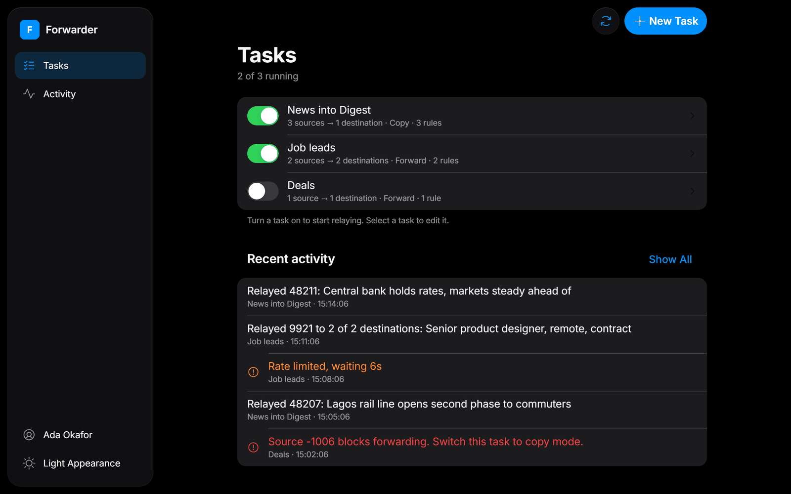
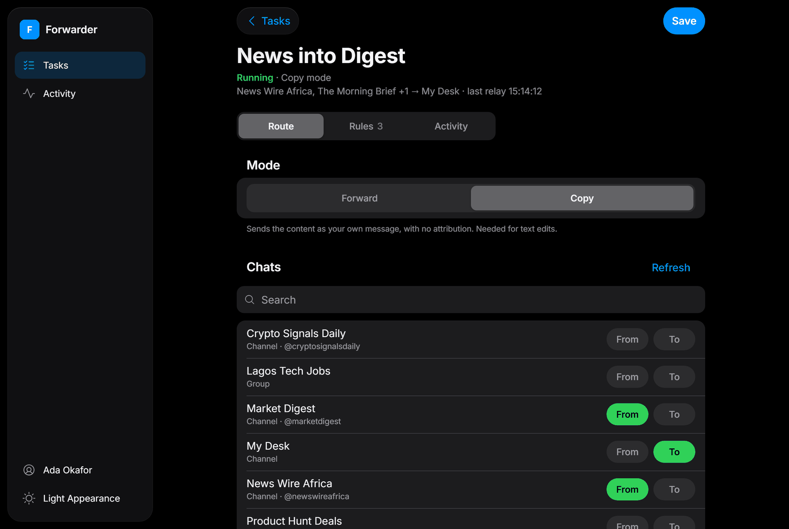
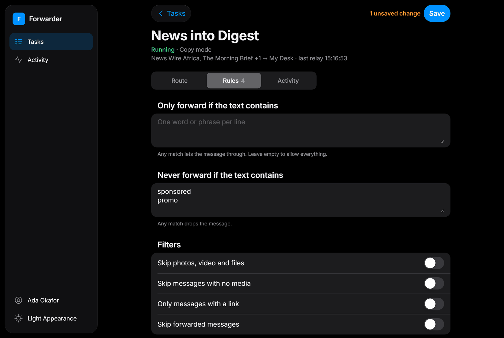
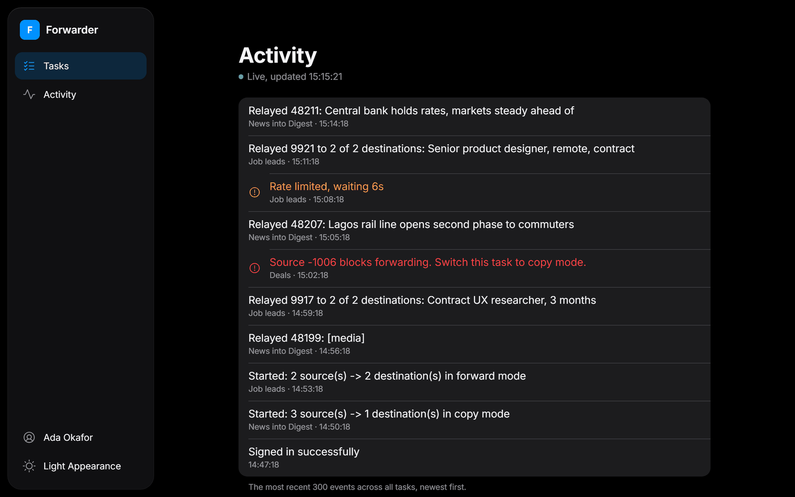
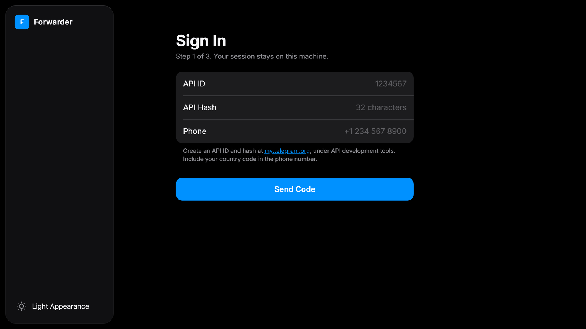
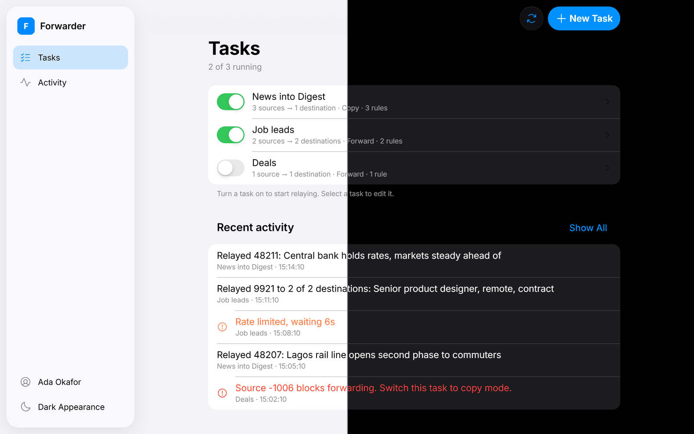
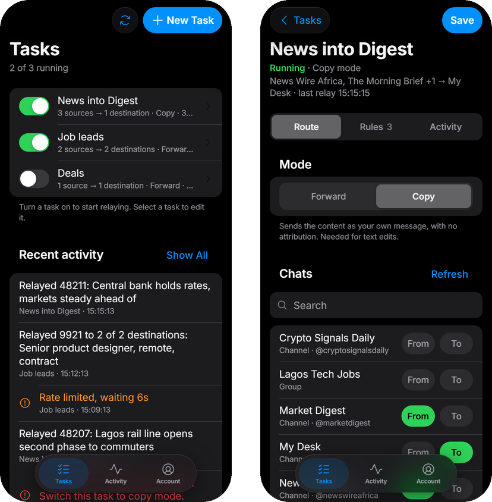

# Telegram Forwarder

Relay new messages from any Telegram groups or channels you're in to chats
you choose, with per-task filters and text edits. Everything runs on your own
machine, managed from a small web app.



It signs in as **your user account** over MTProto, which is what lets it read
channels you merely subscribe to; a bot could only see chats it had been added
to. The login appears in Telegram under **Settings → Devices**, and you can
revoke it there at any time.

## Features

- **Tasks.** Each task has a name, any number of source and destination
  chats, a mode, its own rules and an on/off switch. Running tasks resume
  after a restart.
- **Forward or copy.** Keep the "Forwarded from" header, or re-send the
  content as your own message.
- **Rules.** Allow and block lists, media and link filters, skip forwarded
  posts. In copy mode: remove links or @mentions, find and replace, add a
  footer.
- **Safe by default.** Loops are refused, sends are paced to stay under
  Telegram's rate limits, and a task never relays the same message twice.
- **Live activity.** Every relay, warning and error, as it happens.
- **A proper interface.** Built to Apple's Human Interface Guidelines, with
  light and dark appearance, and it works on a phone.

## A look around

**Edit a task.** Pick where messages come from and where they go, choose a
mode, and see the route and last relay at a glance.



**Set its rules.** Filters drop what you don't want; text edits clean up what
you keep. Unsaved changes are counted next to Save.



<table>
  <tr>
    <td width="50%"></td>
    <td width="50%"></td>
  </tr>
  <tr>
    <td><b>Activity.</b> Everything relayed, newest first, with warnings and errors marked.</td>
    <td><b>Sign in.</b> Telegram's own flow: code, then your two-step password if you use one.</td>
  </tr>
</table>

**Light or dark.** Follows your system by default; switch any time from the
sidebar.



**On your phone.** The sidebar becomes a floating tab bar.

<p align="center">
  
</p>

<sub>Screenshots use made-up sample data.</sub>

## Setup

1. Get an `api_id` and `api_hash` from [my.telegram.org](https://my.telegram.org),
   under **API development tools**.
2. Install and run:

   ```
   python -m venv .venv
   .venv\Scripts\activate
   pip install -r requirements.txt
   python main.py
   ```

   On macOS or Linux, activate with `source .venv/bin/activate`.

3. Open <http://127.0.0.1:8000>.
4. Enter the API credentials and your phone number, then the code Telegram
   sends to your app, then your two-step verification password if you have one.
5. Choose **New Task**, name it, mark chats as **From** (sources) or **To**
   (destinations), and **Save**. Back on Tasks, turn its switch on.

Two kinds of loop are refused rather than run: a task that sends into one of
its own sources, and a task that would close a cycle with another running task.

## Forward modes

- **Forward** keeps the "Forwarded from" header. One API call per message, and
  the cheapest option. It fails if a source channel has content protection on.
- **Copy** re-sends the content as your own message, with no attribution, and
  is required for text edits. Text from protected channels goes through; media
  from them may still be refused by Telegram.

Switch modes at any time in the task editor.

## Rules

Each task carries its own rules, edited on the task's **Rules** tab. The whole
engine is [app/filters.py](app/filters.py); the forwarder itself has no
opinion about what passes.

Rules that drop a message:

- An allow list. If it has entries, the text must contain one of them.
- A block list. Any hit drops the message.
- Skip media, or skip messages that carry no media.
- Only relay messages containing a link.
- Skip messages already forwarded into the source from elsewhere.

Rules that rewrite the text, which need **copy mode**, since a native forward is
the original message untouched:

- Remove links, remove @mentions.
- Find and replace, written one per line as `find => replace`.
- A footer appended to every message.

Allow and block matching is case-insensitive. A task in forward mode with text
edits configured refuses to start rather than silently ignoring them, and the
editor warns you before you get that far. If edits leave nothing but empty
text and there is no media, the message is dropped.

## Pacing

Sends are spaced out so a burst never trips Telegram's rate limiter: at most
one send every 0.25s overall, and one every 1.5s into any single chat. Both
constants are at the top of [app/manager.py](app/manager.py). A busy chat waits
out its own cooldown without delaying sends to other chats. If Telegram asks
for a pause anyway, short waits are slept off and long ones are logged.

## Files that matter

| Path | What it holds |
| --- | --- |
| `data/session/forwarder.session` | Your live Telegram login |
| `data/credentials.json` | api_id and api_hash |
| `data/config.json` | Your tasks: names, sources, destinations, modes, rules |
| `data/seen.json` | Recently relayed ids, for de-duplication |

The whole `data/` directory is git-ignored. Treat the session file as a
password: anyone holding it controls your Telegram account.

## Hosting

This is a long-running process, not a website. Shared cPanel hosting will not
keep it alive. Run it locally, or on any small VPS:

```
docker build -t tg-forwarder .
docker run -d --name tg-forwarder -p 127.0.0.1:8000:8000 -v forwarder-data:/data tg-forwarder
```

The volume is required. Without it, the session is lost on every restart.
Keep the port bound to `127.0.0.1` and reach it over an SSH tunnel; the page
has no authentication of its own and controls a live Telegram account.

To check a host before installing anything, copy over
[hostcheck.py](hostcheck.py) and run `python3 hostcheck.py`. It tests the
Python version, outbound access to Telegram, a writable data directory and
local port binding.

## Known limits

- Albums relay as separate messages rather than one grouped post.
- Edits and deletions in a source do not propagate to the destination.
- Messages posted while the app is stopped are not relayed afterwards.

## Design

The interface follows Apple's Human Interface Guidelines with Apple's system
colours. [design.md](design.md) documents the colours, type, spacing, layout
and every place it departs from Apple's rules.
